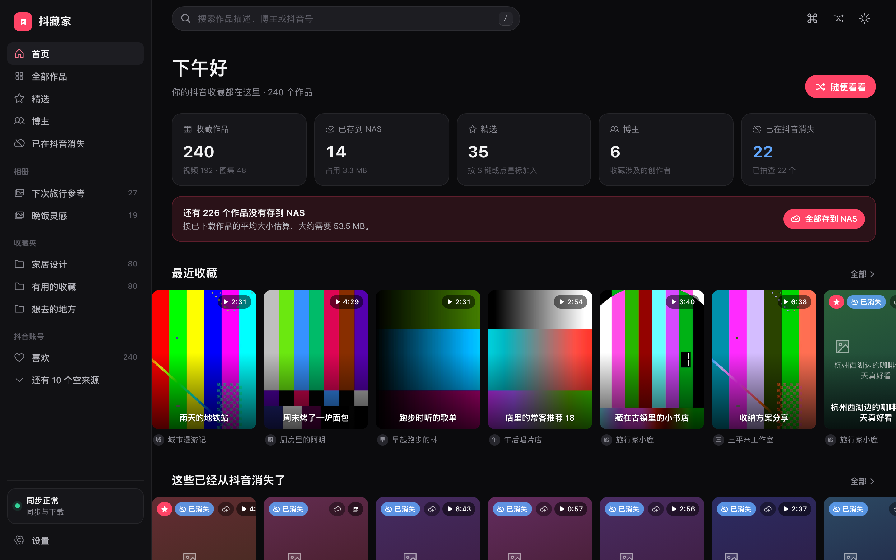
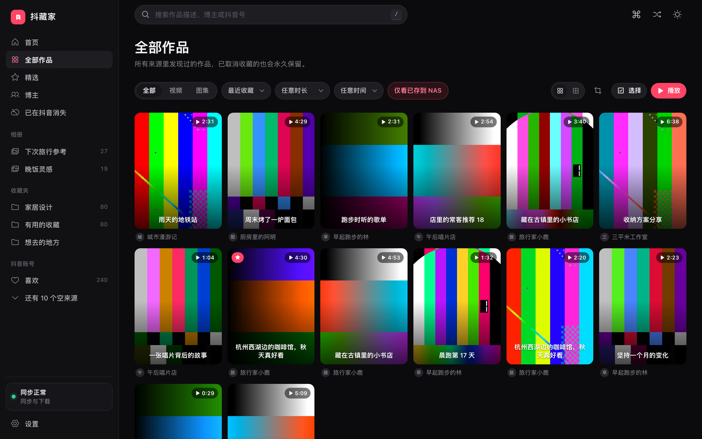
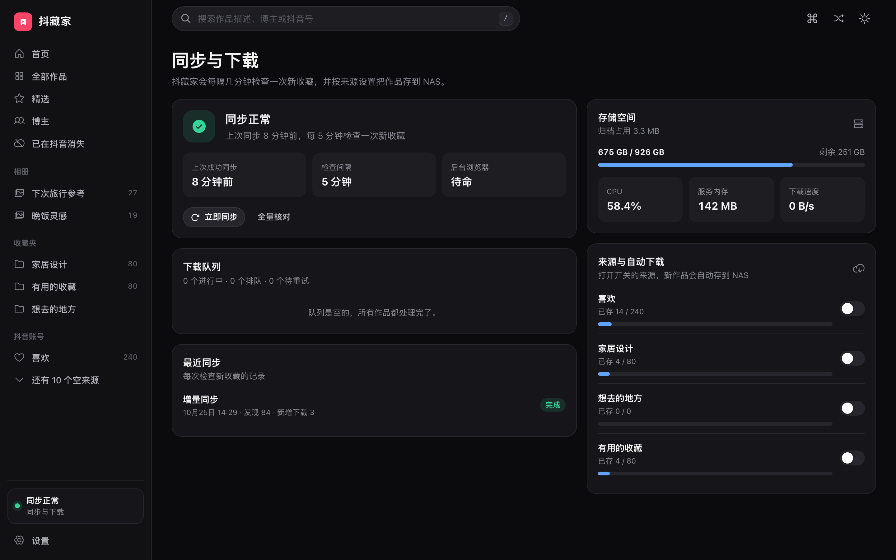
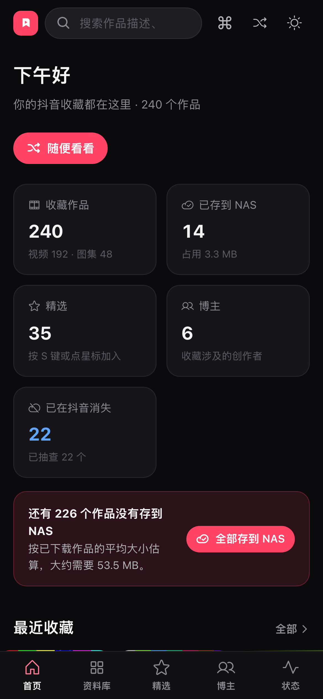

<p align="center">
  
</p>

<h1 align="center">抖藏家</h1>

<p align="center">
  把你在抖音上收藏、点赞、看过的作品，永久保存在自己的 NAS 上，<br/>
  再用一个好看的网页慢慢看。
</p>

<p align="center">
  <a href="LICENSE"></a>
  
  
  
</p>

---

抖音上收藏的东西随时会消失：作者删了、设成私密了、账号没了。抖藏家在你自己的 NAS 上跑一个服务，用你扫码登录的账号，每隔几分钟检查一次新收藏，把原文件下载下来按收藏夹整理好，并且**永远不删**——哪怕你在抖音上取消了收藏。



## 它能做什么

- **自动同步** — 收藏夹、全部收藏、喜欢、作品、稍后再看、观看历史、关注、合集、短剧、收藏音乐，每 5 分钟（可调）检查一次新内容。
- **原文件归档** — 视频和图集按原画质下载到 `objects/`，再按收藏夹名称在 `library/` 下建硬链接，同一作品不重复占空间。断点续传，只增不删。
- **好看的浏览体验** — 沉浸式播放器（键盘、滚轮、手势全支持，自动连播），网格可切密度和比例，悬停预览，深色 / 浅色 / 跟随系统。
- **整理** — 精选、相册、标签、备注，全部只存在 NAS 上；多选后批量操作。
- **搜索** — SQLite FTS5 全文检索，支持中文子串、多词、博主、话题、标签、备注；按时长、收藏时间筛选。
- **“已在抖音消失”** — 后台慢慢抽查每个作品是否还在抖音上，被删除或设为私密的会单独列出来：只有你这里还有。
- **通知** — 登录失效、同步停止、磁盘不足时推送到 Bark、Telegram 或任意 Webhook。
- **状态页** — 同步健康、下载队列、收录任务、存储和每个来源的自动下载开关。
- **手机也好用** — 响应式布局、底部导航、可添加到主屏幕。
- **快捷键** — `⌘K` 命令面板跳到任何收藏夹、相册或博主；`?` 查看全部快捷键。

<table>
  <tr>
    <td></td>
    <td></td>
  </tr>
  <tr>
    <td></td>
    <td></td>
  </tr>
</table>

## 三分钟跑起来

你需要一台能跑 Docker 的机器（NAS、小主机都行）和一个抖音账号。

```bash
git clone https://github.com/RickeyRen/douzangjia.git
cd douzangjia
cp .env.example .env
```

打开 `.env`，生成并填入一个主密钥（用来加密保存的 Cookie）：

```bash
python3 -c "from cryptography.fernet import Fernet; print(Fernet.generate_key().decode())"
```

把 `ARCHIVE_PATH` 改成你想存放视频的目录，`PUID`/`PGID` 改成那个目录的属主（`id -u` / `id -g`），然后：

```bash
docker compose up -d --build
```

打开 `http://<你的NAS地址>:8099`：

1. 创建本地管理员账号（只保存在 NAS 上，用来保护这个网页）。
2. 扫描页面上的抖音二维码。扫码画面是 NAS 里一个真实的 Chromium，遇到滑块验证也可以直接在网页上拖。
3. 第一次全量同步会自动开始，通常十几分钟。之后每 5 分钟增量检查一次。

> **国内构建加速**：`.env.example` 末尾有一组注释掉的镜像源配置（镜像仓库、npm、pip、Debian、Playwright），取消注释再 build 会快很多。

### 也可以直接拉镜像

```yaml
services:
  archive:
    image: ghcr.io/rickeyren/douzangjia:main
    # 其余和仓库里的 compose.yaml 一样
```

## 日常使用

| 想做的事 | 在哪里 |
| --- | --- |
| 看最近收藏、消失的作品、常看的博主 | 首页 |
| 按收藏夹 / 来源浏览 | 左侧栏，或 `⌘K` 直接跳 |
| 随便看看 | 首页「随便看看」，或右上角的随机按钮 |
| 把作品分类整理 | 播放器里「加入相册」，或网格里「选择」后批量加入 |
| 找某个视频 | 顶部搜索框，支持多词、标签、备注 |
| 让新收藏自动下载 | 来源页右上角的「自动存到 NAS」开关（状态页也能统一管） |
| 看同步有没有在正常跑 | 左下角状态灯，或「同步与下载」页 |
| 收到问题提醒 | 设置 → 通知 |

### 快捷键

播放器：`↑ ↓` 切换作品，`← →` 图集翻页，`空格` 暂停，`S` 精选，`M` 静音，`I` 详情，`F` 全屏，`Esc` 关闭。
任何页面：`/` 搜索，`⌘K` 命令面板，`?` 查看全部。

## 配置

环境变量（`.env`）只在启动时读取：

| 变量 | 说明 | 默认 |
| --- | --- | --- |
| `ARCHIVE_MASTER_KEY` | Fernet 密钥，加密保存的 Cookie。**必填**，丢了就要重新扫码 | — |
| `ARCHIVE_PATH` | 宿主机上的归档目录 | `./archive-data` |
| `APP_PORT` | 网页端口 | `8099` |
| `PUID` / `PGID` | 容器内的用户和组 | `1000` / `1000` |
| `TZ` | 时区 | `Asia/Shanghai` |
| `SYNC_INTERVAL_SECONDS` | 同步间隔的初始值 | `300` |
| `SYNC_RUN_TIMEOUT_SECONDS` | 单次同步最长耗时，超过就放弃本次并重启浏览器 | `5400` |

以下在「设置」页里改，立即生效，不用重启：同步间隔、同时下载的任务数、每天抽查远端状态的数量、通知渠道、主题。

## 数据在哪里

```
<ARCHIVE_PATH>/
├── data/
│   ├── archive.sqlite3        # 收藏记录、相册、标签、备注、精选、设置
│   ├── admin.json             # 本地管理员（Argon2 哈希）
│   ├── chromium-profile/      # 抖音登录态，0700
│   └── backups/               # 你手动做的数据库备份
├── objects/<作品ID>/          # 原文件，永不删除
├── library/<收藏夹名>/        # 硬链接视图，方便用文件管理器看
└── cache/                     # 缩略图、头像，删了会自动重建
```

「设置 → 数据与备份」可以直接下载一份一致的数据库副本。媒体文件请用 NAS 自己的备份工具。

## 安全边界（请一定读）

- 这个服务持有你**完整的抖音登录态**。它只应该在家庭局域网里访问，**不要**把 8099 端口暴露到公网。需要外网访问时走 VPN 或带认证的反向代理。
- 本地管理员登录有限流（同一地址或账号连续失败 5 次后锁定，逐次加长）。
- Cookie 用 `ARCHIVE_MASTER_KEY` 加密存库；Chromium Profile 以 `0700` 权限保存，但 NAS 管理员、`root` 和有 Docker 权限的人仍然能读到。
- 抖音可能因为风控、Cookie 过期、设备环境变化要求重新验证。抖藏家不会绕过验证码，只会提醒你重新扫码。
- 容器以非 root、只读根文件系统、`cap_drop: ALL` 运行。

删除 `chromium-profile` 会让抖音把下一次登录视为新设备。遇到 Profile 损坏时服务会把旧目录保留为 `chromium-profile.<原因>.<时间>`，不会自动删除。

## 开发

```bash
# 后端
python -m venv .venv && source .venv/bin/activate
pip install -e ".[browser,worker,dev]"
pytest -q && ruff check src tests

# 前端
cd web && npm ci
npm run dev          # 代理到 http://127.0.0.1:8099，可用 DEV_API_TARGET 覆盖
npx vitest run && npx eslint . && npx tsc -b
```

想看界面但不想连抖音：`ARCHIVE_ROOT=/tmp/demo python scripts/seed_demo.py` 会生成一份假数据，然后用这个目录启动后端。

CI 会在每个 PR 上跑全部测试，并在 `main` 和 `v*` 标签上把镜像推到 GHCR。

## 贡献

欢迎 issue 和 PR。界面文案用的是 gettext 风格（中文原文即键），要添加一种语言只需要在 `web/src/i18n/` 下加一个目录文件。

## 许可证

[MIT](LICENSE)

---

## English

**DouZangJia** is a self-hosted archive for your Douyin favourites. It runs on your NAS, logs in with your own account through a persistent headless Chromium, discovers new favourites every few minutes, downloads the original media, and never deletes anything — even after you un-favourite it on Douyin.

It ships with a polished web library: an immersive player, albums, tags, notes, full-text search (SQLite FTS5 with trigram tokenisation, so Chinese needs no segmentation), a "gone from Douyin" view backed by background availability sampling, push notifications (Bark, Telegram, webhook), a health dashboard, and a mobile layout that installs to the home screen.

```bash
cp .env.example .env   # set ARCHIVE_MASTER_KEY, ARCHIVE_PATH, PUID/PGID
docker compose up -d --build
```

Then open `http://<nas>:8099`, create the local admin, scan the Douyin QR code, and the first full sync starts on its own. Keep the port inside your LAN: the service holds your Douyin session.
